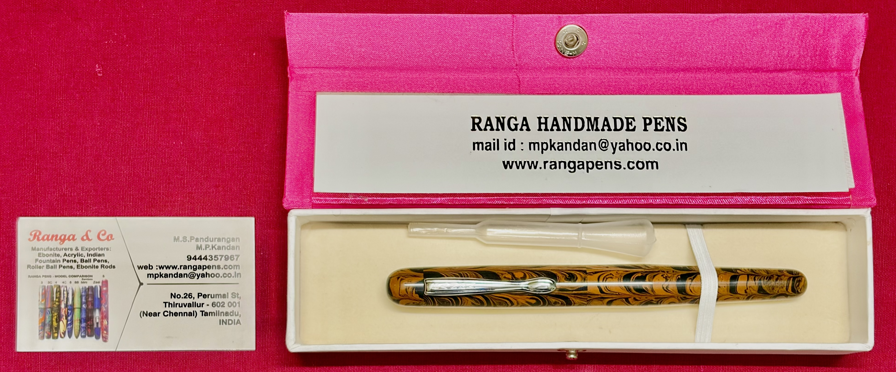
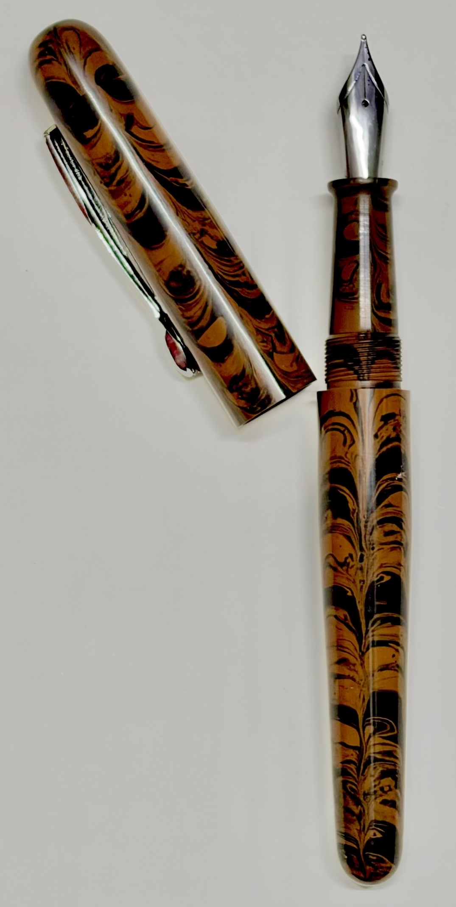
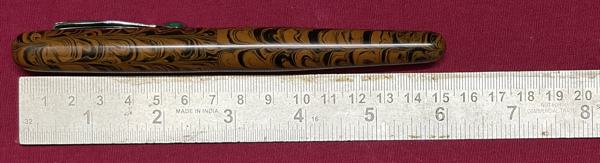
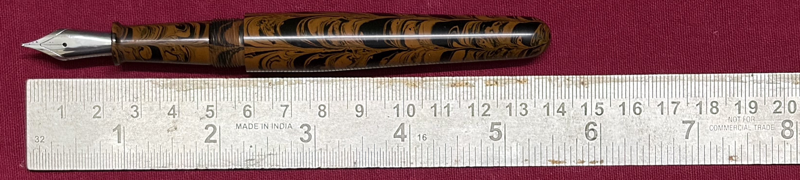
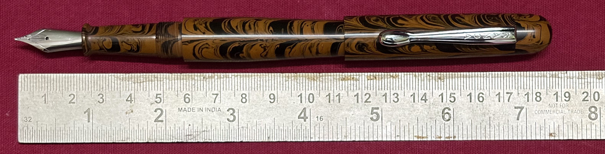
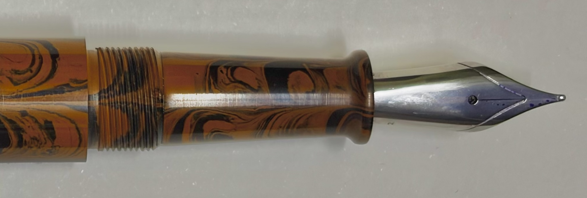
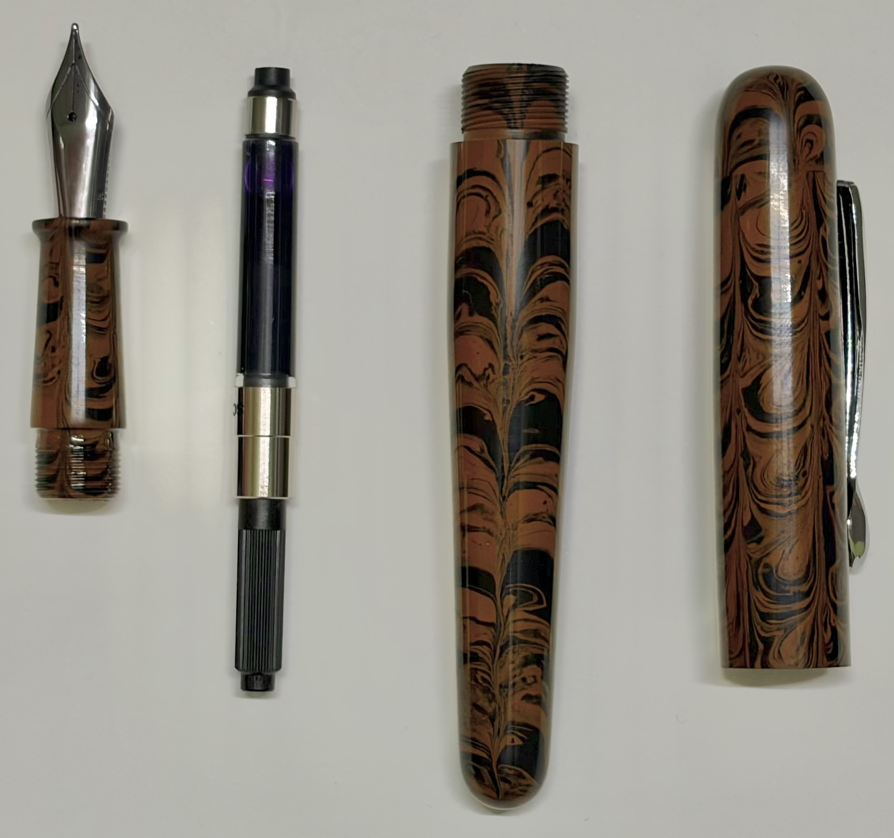

::: {.callout-note}
## At a glance

- **Pen:** Ranga Model 4C, standard ebonite, colour R1 (Brown Ripple)
- **Nib:** JoWo #6 steel, screw-in unit
- **Filling:** 3-in-1 — Schmidt K5 converter, international cartridge, or eyedropper
- **Length when capped:** about 6 inches (152 mm)
- **Cap and barrel diameter:** 16 mm each
- **Grip section:** about 12.5 mm at the thick part, 11 mm where I hold it
- **Price:** ₹3,500
- **Bought from:** Mr. M. P. Kandan at Ranga Pens, over WhatsApp: +91 9444357967
:::

This is not a full technical review. It is simply what I felt about the pen after I opened the box, and what I noticed while writing with it for the first few days.

## How I got it

I did not order through a website. I reached out to Mr. M. P. Kandan at Ranga Pens on WhatsApp, told him the model and the colour I wanted, and placed the order directly with him. He replied himself, answered my questions, and kept it simple from start to finish. If you want a Ranga pen, this is the easiest way to get one.

**The box**

{ width=90% }

## First impression

The pen is beautiful. I had seen photos of brown ripple ebonite before, but a photo does not show how the material actually looks in your hand. In person the brown is deep and warm, and the black lines run around the barrel in a way that changes as you turn it.

What struck me more than the colour was the finish. The ebonite has been turned and polished with real care. I looked closely along the whole body and could not find a single scratch mark. For a pen made by hand, at this price, that says a lot about the person making it. It feels like proper craftsmanship, not a mass-produced item.

## Shape

It is a cigar shaped pen. The bottom of the barrel is rounded, and so is the top of the finial. There are no sharp edges or flat ends anywhere. That rounded shape is not just for looks — it makes the pen feel smooth in the hand and easy to pick up and put down.

The cap posts securely. It sits on the back of the barrel and does not wobble. So you do have the option of posting it while writing.

**Overall shape**

{ width=60% }

## Length and the weight distribution

The pen is 6 inches long and perfectly balanced, at least for my hand. I do not have the right tool to measure the weight with and without the cap, so I cannot give you numbers, but what I can tell you is how it feels: it does not feel heavy at the back or heavy at the front. It just sits in the hand.

Having said that, I prefer to use it without the cap posted. My reason is simple — I worry that posting the cap again and again may leave scratches on the barrel over time and with the cap posted it feels a bit heavier at the top on my hand. So I write with the cap kept aside. Even without the cap, the pen is long enough and balanced enough to be used for a long writing session without my hand getting tired.

**Length of the pen with the cap**

{ width=90% }

**Length of the pen without the cap**

{ width=90% }

**Length of the pen with the cap posted**

{ width=90% }

## The long grip section

The grip section is long, and this is one of my favourite things about the pen. A longer section means there is more room to place your fingers, and you can hold the pen wherever it feels comfortable instead of being forced into one spot near the nib. It gives a very good in-hand feeling, and it is a big part of why long writing sessions with this pen are comfortable.

**Grip section**

{ width=90% }

## The 3-in-1 filling system

This is where the pen becomes really useful. It comes with a Schmidt K5 converter, which is a standard international converter. So out of the box you can fill it from a bottle using the converter.

But that is not the only option:

- **Converter** — the Schmidt K5 that comes with the pen. It holds about 0.8 ml of ink.
- **International cartridges** — if you want to travel light and not carry a bottle, you can just push in a standard international cartridge.
- **Eyedropper** — you can fill the barrel itself with ink using a dropper or a syringe, an eyedropper had already been included in the box.

The eyedropper option is the interesting one. When you fill the barrel directly, the whole body becomes the ink tank, so the capacity jumps to roughly 3.5 to 4 ml. I have not measured this myself — the figure comes from what other Ranga owners have reported for the same family of models — but even at the lower end it is around four times what the converter holds. For someone who writes a lot, that means refilling far less often.

One thing worth knowing before you go the eyedropper route: because the barrel holds so much ink and the feed is plastic, these pens can sometimes burp a little when the ink level gets low. Other owners have reported this too. The simple fix is to keep the barrel reasonably full. With the converter, this is not an issue at all.

## The threaded JoWo nib unit

The pen takes a JoWo #6 nib in a screw-in unit. This matters more than it sounds.

Because the unit is threaded and not glued or friction-fit, the nib can be unscrewed and replaced in seconds. So if the JoWo nib is ever damaged — dropped, bent, badly scratched — the pen is not finished. I can simply buy a Kanwrite #6 nib unit with JoWo threading and screw it in myself. No tools, no sending the pen away, no waiting.

That one detail makes the pen much easier to live with for years. The nib is the part most likely to get damaged, and here it is the easiest part to change.

I recommend to go for a Medium `<M>` nib, as it maintains a balance between the Broad `<B>` and the Fine `<F>`, while giving a consistent smooth writing experience even on the regular notebooks.

**The pen disassembled into components**

{ width=90% }

## Price

I paid ₹3,500 for this pen. For a hand-turned ebonite pen with a German JoWo nib unit and a Schmidt converter, that is a competitive price in the Indian market — in fact, cheaper than what a lot of comparable pens cost. You are getting handmade work and imported components together at a price that does not feel like a stretch.

Do note that Ranga sells the same model with different variants like R1, R2 etc. depending on the quality of the ebonite rod and the patterns. I opted for the cheapest option here, which they call Brown Ripple (R1).

## Delivery

The pen came through DTDC and reached me in West Bengal within 2 to 3 days. That was quick, and I was pleasantly surprised. Of course, delivery time can depend on various factors — where you live, the courier's load, and the time of year — so treat my timeline as a good experience rather than a promise.

## Overall

I am very happy with this pen. It looks good, it feels well made, it is balanced, and it is comfortable for long writing sessions. The 3-in-1 filling system gives me choices, the threaded nib unit means I can repair it myself, and the price is fair for what it is.

If you are thinking of buying your first handmade ebonite pen, this is an easy one to recommend.

[← All fountain pen reviews](../fountain-pen-reviews.html)
